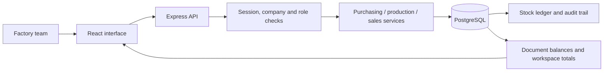

# Madtech Forge — how your ERP works

Forge is an operations application for a small manufacturer. It connects the
office, warehouse, shop floor, and finance team through the same saved records.
The current product has a React interface, an Express API, and PostgreSQL data.

## Start here

Open `http://127.0.0.1:3030` after building and starting the app. The **Explore
demo workspace** button signs into the explicitly labelled demonstration
workspace. Its company is **Green Bamboo Products (Demo)**.

Demo owner: `demo@madtech.local`, password `ForgeDemo@2026!`.
Read-only demo: `viewer@madtech.local`, same development-demo password.

You can also create your own account and an empty company through the sign-up
screen. Your company's data is separate from the demonstration company.

## The three connected workflows

### 1. Buy material, receive it, and pay the supplier

In **Procurement**, create a purchase order by choosing a supplier, a warehouse,
and the items, quantities, and agreed prices.

A purchase order is a plan to buy; it does not increase stock. When material
arrives, use **Receive**. You can receive part of an order and receive the
rest later. Receiving posts a stock movement and increases the warehouse's
on-hand quantity.

Create a supplier bill from the receipt. The bill records what you owe for those
received goods. In **Finance**, record a payment against it. A partial payment
reduces the outstanding amount; the system rejects a payment larger than the
remaining balance.

```text
Purchase order -> Goods receipt -> Supplier bill -> Recorded payment
                       |
                       +-> Raw material stock increases
```

### 2. Turn raw material into finished goods

A **bill of materials (BOM)** is a recipe: how much of each raw material makes
one finished unit. Each new BOM is a version. A work order keeps the recipe and
costs it was planned with, so a later recipe change does not rewrite old jobs.

In **Production**, create a work order from a BOM and choose a warehouse and
planned quantity. **Release**, followed by **Release materials**, issues the planned raw materials from
stock. The system checks availability before posting the complete issue.

**Complete production** records accepted output, rejected output, labour cost,
and any unused material returned. Accepted output becomes finished stock;
rejected output does not. Returned material increases raw stock again.

This version has one completion per work order. Record the whole job's final
accepted/rejected quantities together. The final output may be below the plan,
but cannot exceed it. The displayed job cost uses consumed material and labour.

```text
Recipe -> Work order -> Issue raw material -> Complete production
                                              |
                                              +-> Accepted finished stock
                                              +-> Rejected output record
                                              +-> Unused material returned
```

### 3. Sell finished goods, dispatch them, and collect payment

In **Sales & dispatch**, create an order for a customer. The order reserves available
finished stock. Reserved stock remains physically on hand, but another order
cannot reserve or consume the same units.

Dispatch part or all of the order. Dispatch reduces on-hand stock and releases
the matching reservation. Create an invoice from that dispatch, then record the
customer's collection in **Finance**. Partial collections are supported.

```text
Sales order -> Stock reservation -> Dispatch -> Invoice -> Collection
                                      |
                                      +-> Finished stock decreases
```

## The inventory numbers

| Number | Meaning |
| --- | --- |
| On hand | Quantity physically recorded in the warehouse |
| Reserved | Quantity promised to confirmed sales orders |
| Available | On hand minus reserved |
| Reorder level | Your threshold for replenishing an item |

For example: 1,000 plates on hand and 300 reserved means 700 available.

Every receipt, issue, return, output, dispatch, or adjustment creates a ledger
entry. Posted entries cannot be edited through the app. An adjustment adds a
new movement with a reason; it does not erase the old history. Negative stock
and consuming another order's reserved stock are rejected.

## What the finance numbers mean

- **Invoiced revenue:** total posted customer invoices.
- **Collected:** payments recorded against those invoices.
- **Receivables:** invoiced amounts still due from customers.
- **Payables:** supplier bills still unpaid.
- **Expenses:** separately recorded operating expenses.
- **Inventory value:** indicative on-hand quantity multiplied by current
  standard item cost; it is not FIFO or a statutory stock valuation.

A recorded bank, cash, or UPI payment is an operational record. The app does not
move money through a bank or payment gateway.

This version does not produce statutory profit statements, GST/e-invoices, a
general ledger, or payroll. Returns, credit notes, cancellation/reversal flows,
warehouse transfers, multiple currencies, and multi-stage production are later
product phases. Do not treat operational invoice totals as accounting profit.

## People and access

| Role | Main responsibility |
| --- | --- |
| Owner / admin | Manage the workspace and its operations |
| Purchasing | Suppliers, material catalogue, and purchase/sales orders |
| Warehouse | Goods receipts, stock adjustments, and dispatches |
| Production | Recipes, work orders, material issues, and completion |
| Finance | Bills, invoices, payment records, and expenses |
| Viewer | Read workspace data; cannot post changes |

These are starter roles, with shared read access inside a permitted company.
Use **Workspace → Team** to add people or change a member's role. New accounts
need a password; adding an existing email does not replace that user's password.
No invitation email is sent. Admins cannot grant or modify owner/admin access.
The last owner cannot be demoted.

The server checks company membership and permissions on each request. Company
switching in the UI never grants access by itself. Passwords are hashed with
scrypt. Session cookies are HttpOnly; authentication tokens are not stored in
browser localStorage. State-changing requests also require a CSRF token.

## Useful interaction details

- The left navigation switches between work areas.
- The company selector changes the active permitted workspace.
- Search and status tabs narrow the current documents.
- Click a document to inspect its lines; use the next-step buttons beside table rows to continue the workflow.
- Use the command menu (Ctrl+K) to move around quickly.
- Forms show the posting result and reload current server data.
- Mutations use idempotency keys, so retrying the same network request does not
  post the same stock movement or payment twice.

## How the code connects



| Location | What it contains |
| --- | --- |
| `frontend/src` | Screens, forms, tables, styling, API client |
| `src/modules/auth` | Registration, login, sessions, memberships, team access |
| `src/modules/companies` | Company profiles |
| `src/modules/erp` | Business rules, postings, and workspace reads |
| `database/migrations` | Saved SQL changes, applied in order |
| `scripts/seed*.cjs` | Explicit development demonstration data |
| `tests/integration` | Tests against real PostgreSQL and HTTP APIs |

The browser requests an action. The API checks access and input, then the
service posts all related database changes in one transaction. If a step fails,
the transaction rolls back. The interface receives the result and reloads the
workspace. This is why stock, documents, balances, and history stay connected.

## Run it on your computer

From `D:\Projects\Mad-erp`:

```powershell
npm ci
npm --prefix frontend ci
npm run db:migrate
npm run build
npm run db:seed
npm start
```

Seeding is an explicit development action, disabled when `NODE_ENV=production`.
Running it again does not clear existing business documents. It resets the
known development-demo account passwords, so never use those accounts for
real deployment.

For development, use two terminals:

```powershell
# Terminal 1: backend, port 3030
npm run dev
```

```powershell
# Terminal 2: React development server, port 5176
npm run dev:web
```

The frontend development server forwards API requests to the backend. The
compiled app serves both interface and API at port 3030.

```powershell
npm run typecheck
npm run test:integration
```

Integration tests use their own company/user fixtures and remove only those
fixtures. Their workflows check atomic stock posting, idempotency, company
isolation, permissions, and payment/reservation limits.

Your PostgreSQL settings remain in the ignored `.env` file. Configure
`APP_ORIGINS` for the actual HTTPS application origin when deploying. Review
`identity-and-access.md` for deployment considerations. Deployment, production
backup/restore validation, statutory accounting, and production access hardening
are separate launch work; this build runs locally.
